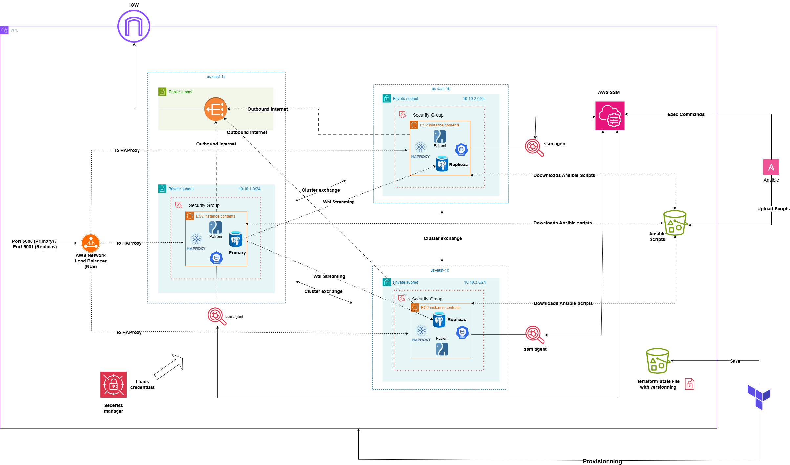

# High-availability-PostgreSQL-Cluster-AWS

This repository contains a complete configuration for deploying a production-grade, production-ready **High-Availability (HA) PostgreSQL Cluster** alongside its full **AWS Infrastructure**.

## 🚀 Project Overview

The architecture is built from the ground up to ensure zero single points of failure, leveraging cloud infrastructure automation, robust configuration management, and AWS native security services.

*   **Complete AWS Infrastructure:** Provisioned via **Terraform**, establishing secure VPC routing, subnets, security groups, and EC2 compute instances.
*   **High-Availability Layer:** Orchestrated using **Patroni** and **etcd** for distributed consensus, automated leader election, and seamless failover handling.
*   **Load Balancing & Routing:** Managed via **HAProxy** to distribute traffic intelligently to the active leader or read-replicas, fronted by an AWS **Network Load Balancer (NLB)** to distribute high-throughput client traffic across the HAProxy nodes.
*   **Automation:** Handled entirely by **Ansible** for predictable, repeatable software installations and cluster configuration.
*   **Secure Secrets Management:** Integrated with **AWS Secrets Manager** to dynamically inject database passwords and sensitive credentials at runtime, ensuring no plaintext secrets are hardcoded in the codebase.
*   **Cluster Administration:** Leverages **AWS Systems Manager (SSM)** Session Manager for secure, keyless SSH access and centralized administration of the cluster nodes without exposing ports to the public internet.

---

## 🚧 Documentation & Features: In Progress

> [!NOTE]
> Detailed deployment guides, step-by-step setup guides, and advanced feature additions are currently **in progress**. 

This version represents the core functional codebase for the architecture. Expanded documentation and configuration templates are being actively committed. 

**Stay tuned!** ✨